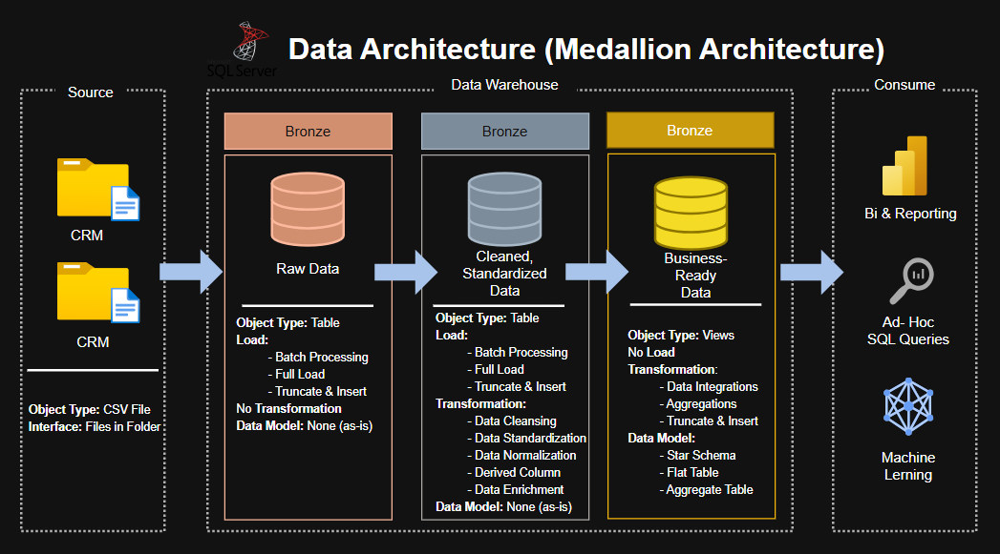
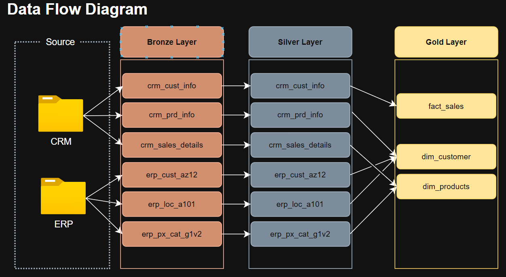
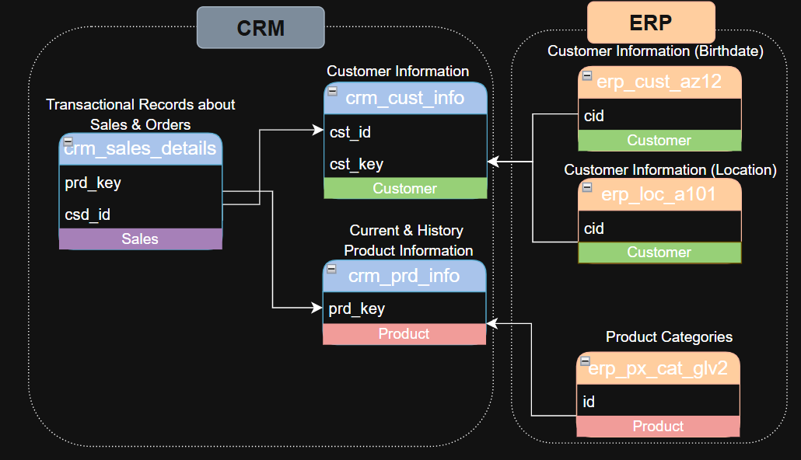
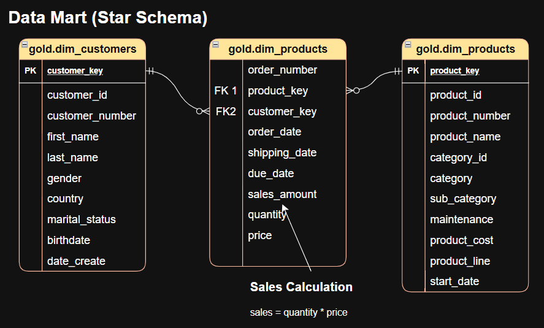

# Data Warehouse and Analytics Project

A hands-on data engineering project focused on building a modern data warehouse using **Microsoft SQL Server**. The project integrates CRM and ERP source data using the Medallion Architecture to transform raw data into clean, structured, and analysis-ready datasets.

**The main goal of this project is to gain real, hands-on experience in data engineering** by applying SQL skills to data ingestion, transformation, data modeling, and data quality validation. This project follows the educational tutorial by Baraa Khatib Salkini from Data With Baraa as a learning reference.

## Project Overview

This project aims to build a centralized data warehouse that consolidates sales-related data from multiple source systems, improves data quality, and prepares datasets for analytical reporting.

Through practical implementation, I aim to strengthen my understanding of data engineering workflows and learn how data moves from raw source files to business-ready datasets.

### Objectives

- Gain hands-on experience in data warehouse development.
- Load CRM and ERP data from CSV files.
- Implement the Bronze, Silver, and Gold layers using Medallion Architecture.
- Clean, standardize, and transform data using SQL.
- Integrate data from multiple source systems.
- Design a data model for analytical queries and reporting.
- Validate data quality in the Silver and Gold layers.
- Analyze customer behavior, product performance, and sales trends using SQL.

## Data Architecture

The project follows the **Medallion Architecture**, which organizes data into three layers.



### Bronze Layer

Stores raw data ingested from the CRM and ERP source files, preserving the original data as closely as possible.

### Silver Layer

Cleans, standardizes, and transforms data from the Bronze layer to improve consistency and prepare datasets for integration.

### Gold Layer

Organizes processed data into business-ready tables, using fact and dimension modeling to support analytical queries and reporting.

## Project Structure

```text
data-warehouse-project/
├── datasets/
│
├── docs/
│   ├── data_architecture.png
│   ├── data_catalog.md
│   ├── data_flow_diagram.png
│   ├── data_integration_diagram.png
│   ├── data_model.png
│   └── naming_convention.md
│
├── scripts/
│   ├── bronze/
│   │   ├── ddl_bronze.sql
│   │   └── proc_load_bronze.sql
│   ├── silver/
│   ├── gold/
│   │   └── ddl_gold.sql
│   └── init_database.sql
│
├── tests/
│   ├── quality_check_gold.sql
│   └── quality_check_silver.sql
│
├── LICENSE
└── README.md
```

## Directory Description

| Directory/File | Description |
|---|---|
| `datasets/` | Stores the source CSV files from the CRM and ERP systems. |
| `docs/` | Contains project diagrams, data documentation, and naming conventions. |
| `scripts/bronze/` | Contains scripts for creating Bronze tables and loading raw data. |
| `ddl_bronze.sql` | Defines the Bronze layer tables. |
| `proc_load_bronze.sql` | Contains the stored procedure or procedures for loading source data into Bronze. |
| `scripts/silver/` | Contains scripts for cleansing, standardization, and transformation. |
| `scripts/gold/` | Contains scripts for creating Gold layer tables. |
| `ddl_gold.sql` | Defines the Gold layer tables. |
| `init_database.sql` | Initializes the database and required schemas. |
| `tests/` | Contains SQL scripts for checking Silver and Gold data quality. |
| `LICENSE` | Contains the project's licensing terms. |
| `README.md` | Documents the project, architecture, workflow, and implementation. |

## Technologies Used

- **Microsoft SQL Server** – Database and data warehouse development.
- **SQL** – Data ingestion, cleansing, transformation, and validation.
- **CSV** – Source data format.
- **Git and GitHub** – Version control and project documentation.
- **Draw.io** – Data architecture and modeling diagrams.

## Data Engineering Workflow

1. **Database Initialization** – Create the database and required schemas.
2. **Bronze Layer** – Define raw data tables and load CRM and ERP source files.
3. **Silver Layer** – Clean, standardize, and transform the ingested data.
4. **Gold Layer** – Build business-ready tables for analytics.
5. **Data Quality Testing** – Validate the Silver and Gold datasets using SQL.
6. **Analytics and Reporting** – Analyze customer behavior, product performance, and sales trends.

## Documentation

The `docs/` directory contains diagrams and documentation describing the data warehouse design.

### Data Flow Diagram

Illustrates how data moves through the data warehouse pipeline.



### Data Integration Diagram

Shows how data from the CRM and ERP source systems is integrated.



### Data Model

Illustrates the structure and relationships between tables used in the analytical data model.



### Additional Documentation

- **[Data Catalog](docs/data_catalog.md)** – Describes datasets and their attributes.
- **[Naming Convention](docs/naming_convention.md)** – Defines naming rules used throughout the project.

## Learning Resources and Acknowledgment

Special thanks to **Baraa Khatib Salkini from [Data With Baraa](https://www.datawithbaraa.com/)** for creating an educational, beginner-friendly tutorial that guides learners through building a SQL Server data warehouse.

His step-by-step explanations serve as a valuable learning reference as I gain hands-on experience with data ingestion, the Medallion Architecture, data transformation, and data modeling.

This project follows his tutorial, with the repository organized according to my own directory structure as I work through the implementation and develop my data engineering skills.

**Original resources:**

- **YouTube Channel:** [Data With Baraa](https://www.youtube.com/@datawithbaraa)
- **Original Repository:** [SQL Data Warehouse Project](https://github.com/DataWithBaraa/sql-data-warehouse-project)
- **Tutorial Video:** [Building a Modern Data Warehouse](https://youtu.be/9GVqKuTVANE)
- **Website:** [datawithbaraa.com](https://www.datawithbaraa.com/)

Please refer to the original repository for its license and attribution requirements.

## Project Status

This project is part of my ongoing data engineering learning journey. Its implementation progresses through the following stages:

- Database initialization
- Bronze layer table creation and data loading
- Silver layer data cleansing and transformation
- Gold layer development and analytical data modeling
- Data quality validation
- SQL-based analytics

## License

Please refer to the included `LICENSE` file and the [original repository](https://github.com/DataWithBaraa/sql-data-warehouse-project) for applicable licensing and attribution requirements.

