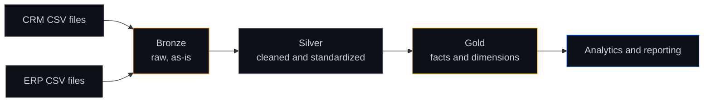
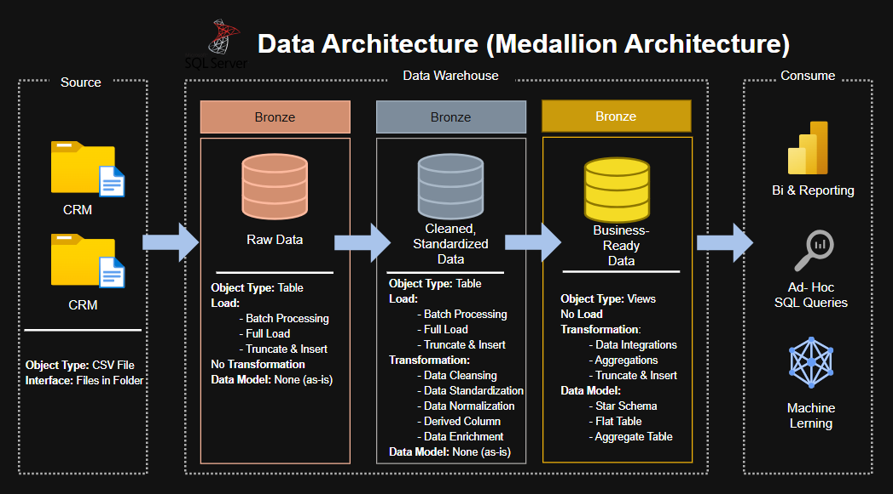

<div align="center">


**A modern data warehouse built in Microsoft SQL Server that turns raw CRM and ERP files into analysis-ready data.**

[Overview](#overview) · [Architecture](#architecture) · [Project Structure](#project-structure) · [Getting Started](#getting-started) · [Documentation](#documentation) · [Acknowledgment](#acknowledgment)

</div>

---

## Overview

This project builds a centralized data warehouse that consolidates sales-related data from two source systems (CRM and ERP), improves its quality, and prepares it for analytical reporting. Data moves through the three layers of the **Medallion Architecture**, each implemented in SQL.

## Purpose

The goal is real, hands-on data engineering experience: applying SQL to data ingestion, transformation, data modeling, and data quality validation, and understanding how data moves from raw source files to business-ready datasets.

**Objectives**

- Load CRM and ERP data from CSV files.
- Implement the Bronze, Silver, and Gold layers.
- Clean, standardize, and integrate data from multiple source systems.
- Design a fact and dimension model for analytical queries.
- Validate data quality in the Silver and Gold layers.
- Analyze customer behavior, product performance, and sales trends with SQL.

## Architecture



| Layer | Role |
|---|---|
| **Bronze** | Stores raw data from the CRM and ERP files, preserved as closely as possible to the source. Loaded with `BULK INSERT` by the `bronze.load_bronze` stored procedure. |
| **Silver** | Cleans, standardizes, and transforms Bronze data so the two sources can be integrated. |
| **Gold** | Business-ready tables organized as facts and dimensions for analytical queries and reporting. |



## Tech Stack

| Tool | Used for |
|---|---|
| Microsoft SQL Server | Database and data warehouse |
| T-SQL | Ingestion, cleansing, transformation, stored procedures, and quality checks |
| CSV | Source data format |
| Draw.io | Architecture and data model diagrams |
| Git and GitHub | Version control and documentation |

## Project Structure

```text
sql-data-warehouse-project/
├── datasets/                  # Source CSV files from the CRM and ERP systems
├── docs/                      # Diagrams, data catalog, and naming conventions
├── scripts/
│   ├── init_database.sql      # Creates the database and the bronze/silver/gold schemas
│   ├── bronze/
│   │   ├── ddl_bronze.sql     # Bronze table definitions
│   │   └── proc_load_bronze.sql
│   ├── silver/
│   │   ├── dd_silver.sql      # Silver table definitions
│   │   └── proc_load_silver.sql
│   └── gold/
│       └── ddl_gold.sql       # Gold layer objects (facts and dimensions)
├── tests/
│   ├── quality_check_silver.sql
│   └── quality_check_gold.sql
└── LICENSE
```

## Getting Started

**Prerequisites:** Microsoft SQL Server and a SQL client such as SQL Server Management Studio.

Run the scripts in layer order:

1. `scripts/init_database.sql` to create the database and schemas.
2. `scripts/bronze/ddl_bronze.sql`, then load raw data:
   ```sql
   EXEC bronze.load_bronze;
   ```
3. `scripts/silver/dd_silver.sql` and `scripts/silver/proc_load_silver.sql` to build and load the Silver layer.
4. `scripts/gold/ddl_gold.sql` to build the Gold layer.
5. `tests/quality_check_silver.sql` and `tests/quality_check_gold.sql` to validate the results.

## Documentation

| Document | What it shows |
|---|---|
| [Data Flow Diagram](docs/data_flow_diagram.png) | How data moves through the pipeline |
| [Data Integration Diagram](docs/data_integration_diagram.png) | How CRM and ERP data are joined |
| [Data Model](docs/data_model.png) | Tables and relationships in the analytical model |
| [Data Catalog](docs/data_catalog.md) | Datasets and their attributes |
| [Naming Convention](docs/naming_convention.md) | Naming rules used throughout the project |

## Project Status

In progress, as part of an ongoing data engineering learning journey:

- Database initialization
- Bronze layer tables and data loading
- Silver layer cleansing and transformation
- Gold layer and analytical data model
- Data quality validation
- SQL-based analytics

## Acknowledgment

This project follows the educational tutorial by **Baraa Khatib Salkini** from [Data With Baraa](https://www.datawithbaraa.com/), with the repository organized in my own structure as I work through the implementation.

- Original repository: [DataWithBaraa/sql-data-warehouse-project](https://github.com/DataWithBaraa/sql-data-warehouse-project)
- Tutorial video: [Building a Modern Data Warehouse](https://youtu.be/9GVqKuTVANE)
- YouTube channel: [Data With Baraa](https://www.youtube.com/@datawithbaraa)

## License

Released under the [MIT License](LICENSE). Please also see the [original repository](https://github.com/DataWithBaraa/sql-data-warehouse-project) for its own license and attribution requirements.

---

<div align="center">
<sub>Part of the <a href="https://github.com/nixxinix">nixxinix</a> project portfolio</sub>
</div>
